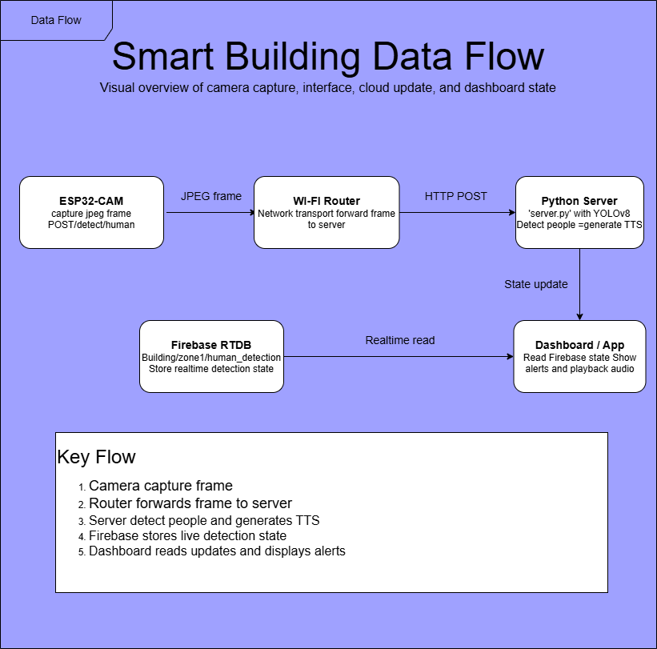

# Smart Building — ESP32-CAM Edge AI Human Detection & Cloud Telemetry

[](https://github.com/HmzaHch/LastSmartBuilding)
[](https://github.com/HmzaHch/LastSmartBuilding)
[](https://github.com/HmzaHch/LastSmartBuilding)
[](https://firebase.google.com/)
[](LICENSE)

An end-to-end cyber-physical IoT system designed for modern smart building security, human presence verification, and automated facility monitoring. The platform bridges low-power microcontroller hardware with deep-learning computer vision inference at the edge, real-time cloud synchronization, and an interactive monitoring dashboard.

---

## 🏛️ System Architecture

The following diagram illustrates the interaction between edge nodes, the AI inference backend, cloud databases, and client dashboards:



```text
[ ESP32-CAM Edge Node ]
      │ (Raw JPEG Frame via HTTP POST)
      ▼
[ Python AI Server (`server.py`) ]
      │
      ├──> [ YOLOv8n Inference (Human Detection) ]
      ├──> [ Audio Generation / Base64 TTS Alert ]
      ├──> [ Firebase Realtime Database Sync ]
      │
      ▼ (JSON Response + Audio Stream)
[ ESP32-CAM Alert Feedback ] ──> LED Flash / SPIFFS Audio Playback
      │
      ▼
[ Web Monitoring Dashboard (`index.html`) ] ──> Live Zone Status & Security Telemetry
```

---

## ✨ Key Features

- **Edge Vision Capture:** ESP32-CAM streaming high-efficiency JPEG frames over Wi-Fi with optimized frame rates.
- **Deep Learning Object Detection:** YOLOv8n (Ultralytics) inference pipeline filtered specifically for human presence detection (`class: person`).
- **Autonomous Local Alerting:**
  - Onboard High-Power Flash LED triggers upon unauthorized or detected human entry.
  - SPIFFS onboard flash storage holds audio alert files (`/audio.mp3`) with localized playback capability.
- **Cloud Synchronization:** Instantaneous telemetry updates to **Firebase Realtime Database** (`building/zone1/human_detection`), enabling remote monitoring from anywhere.
- **Interactive Web Dashboard:** Clean, responsive monitoring UI visualizing zone activity, alert timestamps, and sensor telemetry cards.

---

## 🛠️ Tech Stack & Requirements

| Layer | Technologies / Tools |
| :--- | :--- |
| **Microcontroller / Firmware** | ESP32-CAM (OV2640 sensor), Arduino C++, SPIFFS File System, HTTPClient |
| **Inference Server** | Python 3.9+, OpenCV (`cv2`), Ultralytics YOLOv8 (`yolov8n.pt`), Flask/HTTP server |
| **Cloud & Database** | Firebase Admin SDK, Firebase Realtime Database |
| **Frontend Dashboard** | HTML5, Modern CSS, JavaScript (Fetch API / SSE) |

---

## 🚀 Getting Started

### 1. Prerequisites
Clone the repository:
```bash
git clone https://github.com/HmzaHch/LastSmartBuilding.git
cd LastSmartBuilding
```

### 2. Python AI Server Setup
Create a virtual environment and install the required dependencies:
```bash
python -m venv .venv
# On Windows:
.venv\Scripts\activate
# On Linux/macOS:
source .venv/bin/activate

pip install -r requirements.txt
```

Start the inference server:
```bash
python server.py
```
*The server will initialize the YOLOv8 model and listen on `http://0.0.0.0:5000` (or configured port).*

### 3. ESP32-CAM Firmware Flash
1. Open `cam01/cam01.ino` in the Arduino IDE or PlatformIO.
2. Configure your Wi-Fi credentials:
   ```cpp
   const char* ssid = "YOUR_WIFI_SSID";
   const char* password = "YOUR_WIFI_PASSWORD";
   ```
3. Update the server endpoint with your local server IP:
   ```cpp
   const char* SERVER_IP = "192.168.1.XXX";
   const int SERVER_PORT = 5000;
   ```
4. Select board **AI Thinker ESP32-CAM** and upload the code.

### 4. Real-time Dashboard
Open `index.html` in your web browser (Chrome, Edge, or Opera) to view live zone telemetry and detection events.

---

## 📡 API Endpoints

| Method | Endpoint | Description |
| :--- | :--- | :--- |
| `POST` | `/detect/human` | Accepts raw JPEG image payload, runs YOLOv8 detection, returns JSON + audio |
| `GET` | `/health` | Health check endpoint returning server and model status |
| `GET` | `/check` | ESP32 endpoint checking latest detection state |
| `GET` | `/audio.mp3` | Serves base64 decoded alert audio stored in SPIFFS |

---

## 👨‍💻 Author

**Hamza HACHOUM**  
*State Engineer in Applied Sciences and Technology (Embedded Systems & IoT)*  
*ISIMG, University of Gabès*  
- **LinkedIn:** [hamza-hachoum-186319227](https://www.linkedin.com/in/hamza-hachoum-186319227)  
- **GitHub:** [@HmzaHch](https://github.com/HmzaHch)  
- **Email:** hamza.hachoum@gmail.com
